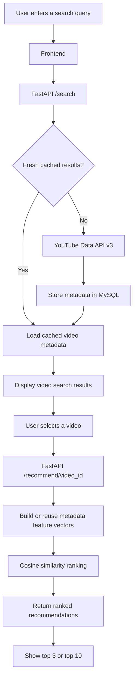

<div align="center">

# YouTube Video Recommendation System

| | |
| :---: | :---: |
|  |  |
|  |  |

A full-stack, content-based YouTube video discovery app that lets you search for videos, select one, and explore similar recommendations through a clean web interface.

<br/>


**Frontend · FastAPI Backend · MySQL · YouTube Data API v3 · Content-Based Filtering**

<br/>

[Features](#-features) · [How It Works](#-how-it-works) · [Quick Start](#-quick-start) · [API Reference](#-api-reference) · [Troubleshooting](#-troubleshooting)

</div>

---

## ✨ Features

<table>
<tr>
<td width="50%">

### 🔎 YouTube Search
Search videos through the YouTube Data API and display results with thumbnails, titles, channels, and available metadata.

</td>
<td width="50%">

### 🧠 Similarity-Based Recommendations
Rank candidate videos using textual metadata and cosine similarity to find videos related to the one you selected.

</td>
</tr>
<tr>
<td>

### ⚡ MySQL Caching
Cache search results and recommendation data to reduce repeated work and avoid unnecessary API requests when cached results are still valid.

</td>
<td>

### 🧩 Reusable Feature Vectors
Persist sparse text feature vectors so cached video metadata can be reused for ranking.

</td>
</tr>
<tr>
<td>

### 🎬 Top 3 or Top 10
See a short list first, then expand the interface to show up to ten recommendations.

</td>
<td>

### 📊 Interaction Endpoint
Record events such as clicks, likes, dislikes, skips, and watches for future analytics or personalization work.

</td>
</tr>
</table>

> [!NOTE]
> This is a learning project, not a replica of YouTube's proprietary recommendation algorithm. The current recommender ranks candidates from the active search-result pool; selecting a video does **not** automatically trigger a separate broad discovery search.

## 🖥️ Project Preview

The frontend is designed around a simple discovery flow:

1. Search for a topic, creator, or video.
2. Browse the returned YouTube results.
3. Select **Find similar** on a video.
4. Explore the top three recommendations or expand the list to ten.
5. Open any video on YouTube.

> **Local demo:** the frontend and backend run on your own machine. This repository does not imply that a public hosted demo is available.

## 🧰 Tech Stack

| Layer | Technologies | Responsibility |
|---|---|---|
| Frontend | HTML, CSS, JavaScript | Search UI, video cards, recommendation display |
| Backend | Python, FastAPI, Uvicorn | API routes and recommendation workflow |
| Video data | YouTube Data API v3 | Search results and video metadata |
| Database | MySQL or MariaDB (XAMPP works locally) | Search cache, metadata, vectors, recommendation cache, interactions |
| Text features | scikit-learn `HashingVectorizer`, SciPy | Convert metadata text to sparse feature vectors and compare similarity |
| API testing | FastAPI / Swagger UI | Test routes at `/docs` |

## 🧭 How It Works



### Recommendation pipeline

- **Collect:** fetch video results and available metadata for the user's query.
- **Cache:** store results and metadata in MySQL for reuse while the cache is valid.
- **Represent:** combine relevant textual metadata into feature text. Video IDs and URLs are retained for display but excluded from the text used for similarity.
- **Vectorize:** use a stable hashing-based text vectorizer to create sparse feature vectors.
- **Rank:** compare the selected video with other candidates using cosine similarity.
- **Display:** return ranked candidates to the frontend.

The quality of recommendations depends on the metadata returned by YouTube. Tags, likes, and some fields may be missing for certain videos.

## 🚀 Quick Start

<details open>
<summary><strong>1. Prerequisites</strong></summary>

Install or prepare the following:

- [Python](https://www.python.org/downloads/) 3.10 or newer
- [Git](https://git-scm.com/downloads)
- [XAMPP](https://www.apachefriends.org/) or another MySQL/MariaDB server
- A Google Cloud project with **YouTube Data API v3** enabled and an API key
- A modern browser

</details>

<details open>
<summary><strong>2. Clone the repository</strong></summary>

```bash
git clone https://github.com/ranjeet22/Youtube-Video-Recommendation-System.git
cd YOUR_REPOSITORY
```

Replace the repository URL with your actual GitHub repository URL.

Expected layout:

```text
.
├── Backend/
│   ├── app/
│   ├── pipeline.py
│   ├── schema.sql
│   ├── requirements.txt
│   ├── .env.example
│   └── README.md
├── Frontend/
│   ├── index.html
│   ├── styles.css
│   ├── app.js
│   ├── config.js
│   └── README.md
└── README.md
```

Folder capitalization is shown as `Backend/` and `Frontend/`; use the names that actually exist in your repository.

</details>

<details open>
<summary><strong>3. Configure MySQL with XAMPP</strong></summary>

1. Open the XAMPP Control Panel.
2. Start **MySQL**.
3. Open [phpMyAdmin](http://localhost/phpmyadmin).
4. Choose **Import** and import `Backend/schema.sql`.
5. Confirm that the database and tables were created.

The default local configuration uses:

| Setting | Default |
|---|---|
| Host | `127.0.0.1` |
| Port | `3306` |
| User | `root` |
| Password | Empty by default in a standard local XAMPP setup |
| Database | `youtube_recommender` |

If your MySQL credentials differ, update the environment variables in the next step. Never expose a database server publicly just to run this local demo.

</details>

<details open>
<summary><strong>4. Configure the backend environment</strong></summary>

Open a terminal in `Backend/`.

**Windows PowerShell:**

```powershell
Copy-Item .env.example .env
```

**macOS / Linux:**

```bash
cp .env.example .env
```

Open `Backend/.env` and add your own YouTube API key:

```dotenv
YOUTUBE_API_KEY=YOUR_YOUTUBE_DATA_API_V3_KEY
MYSQL_HOST=127.0.0.1
MYSQL_PORT=3306
MYSQL_USER=root
MYSQL_PASSWORD=
MYSQL_DATABASE=youtube_recommender
CACHE_TTL_HOURS=24
VECTOR_VERSION=hashing-v1
DEFAULT_SEARCH_RESULTS=15
```

Get a key from the [Google Cloud Console](https://console.cloud.google.com/). Select or create a project, enable **YouTube Data API v3**, then create an API key. Restrict the key appropriately in Google Cloud.

**Security checklist**

- Keep `.env` local. Do not commit API keys, database passwords, or other secrets.
- Commit `.env.example` with placeholder values instead.
- If a real key was ever committed, remove it from the repository and rotate/restrict it in Google Cloud. Deleting it in a later commit does not remove it from Git history.
- The YouTube API has quota limits. Caching can reduce repeat requests, but it does not make new searches free.

</details>

<details open>
<summary><strong>5. Install and start the backend</strong></summary>

Still inside `Backend/`:

**Windows PowerShell**

```powershell
py -m venv .venv
.\.venv\Scripts\Activate.ps1
python -m pip install --upgrade pip
pip install -r requirements.txt
uvicorn pipeline:app --reload
```

If PowerShell blocks activation, use Command Prompt:

```bat
.venv\Scripts\activate.bat
```

**macOS / Linux**

```bash
python3 -m venv .venv
source .venv/bin/activate
python -m pip install --upgrade pip
pip install -r requirements.txt
uvicorn pipeline:app --reload
```

The API should now be available at:

- API root: <http://127.0.0.1:8000/>
- Health check: <http://127.0.0.1:8000/health>
- Interactive API docs: <http://127.0.0.1:8000/docs>

Confirm the health check reports that the database is connected and the YouTube API key is configured before moving on.

</details>

<details open>
<summary><strong>6. Configure and start the frontend</strong></summary>

Open `Frontend/config.js` and confirm the API URL points to your local backend:

```javascript
window.REELFIND_CONFIG = {
  API_BASE_URL: "http://127.0.0.1:8000"
};
```

Open a **second terminal** in `Frontend/` and start a local static server:

```bash
py -m http.server 5500
```

On macOS/Linux, if `py` is not available, use:

```bash
python3 -m http.server 5500
```

Visit <http://127.0.0.1:5500> in your browser.

### If the browser reports a CORS error

The frontend and backend use different ports, so the FastAPI backend must allow the frontend's origin. In `Backend/pipeline.py`, add this import:

```python
from fastapi.middleware.cors import CORSMiddleware
```

After the FastAPI `app` is created, add:

```python
app.add_middleware(
    CORSMiddleware,
    allow_origins=[
        "http://127.0.0.1:5500",
        "http://localhost:5500",
    ],
    allow_credentials=True,
    allow_methods=["*"],
    allow_headers=["*"],
)
```

Restart Uvicorn after saving. For production, replace local origins with your actual frontend domain rather than allowing every origin.

</details>

## 🧪 Test the Application

- [ ] `/health` responds successfully and reports the database connection.
- [ ] Search for a topic such as `python programming`.
- [ ] Confirm video cards and thumbnails appear.
- [ ] Select **Find similar** on a result.
- [ ] Confirm recommendations load.
- [ ] Switch between **Top 3** and **Show top 10**.
- [ ] Open a video on YouTube.
- [ ] Repeat a search to exercise the database cache.

## 🔌 API Reference

Base URL for local development: `http://127.0.0.1:8000`

| Method | Endpoint | Purpose |
|---|---|---|
| `GET` | `/` | Basic API information |
| `GET` | `/health` | Check API/database configuration |
| `GET` | `/search?q=python%20programming&region_code=IN&language=en&max_results=15` | Search YouTube videos |
| `GET` | `/recommend/VIDEO_ID?q=python%20programming&region_code=IN&language=en&max_results=15&top_n=10` | Rank related candidates |
| `POST` | `/interactions` | Record a user interaction |

### Example: record an interaction

Send a `POST` request to `/interactions` with JSON like this, replacing the video ID with one returned by your search:

```json
{
  "video_id": "VIDEO_ID_FROM_SEARCH",
  "interaction_type": "click",
  "user_id": "optional-local-user-id",
  "watch_duration_seconds": 30
}
```

Supported interaction types: `click`, `like`, `dislike`, `skip`, and `watch`.

For the authoritative parameter list and live response schemas, open the local [Swagger UI](http://127.0.0.1:8000/docs) while the backend is running.

## 🗄️ What MySQL Stores

The backend schema is designed to support:

- Cached search responses
- Video metadata
- Reusable sparse video vectors
- Cached recommendation rankings
- Recorded interactions

Caching behaviour is controlled by `CACHE_TTL_HOURS`. If vectorization settings change, update `VECTOR_VERSION` so old stored vectors can be recalculated.

## 🛠️ Troubleshooting

<details>
<summary><strong>Backend health check fails</strong></summary>

- Verify Uvicorn is running in the `Backend/` directory.
- Confirm `Backend/.env` exists and contains the correct settings.
- Start MySQL in XAMPP and verify the database was created by importing `schema.sql`.
- Check that port `8000` is not already in use.

</details>

<details>
<summary><strong>Database connection error</strong></summary>

- Check `MYSQL_HOST`, `MYSQL_PORT`, `MYSQL_USER`, `MYSQL_PASSWORD`, and `MYSQL_DATABASE`.
- Confirm the MySQL service is running.
- If you changed the database name, make sure it matches the schema and `.env` configuration.

</details>

<details>
<summary><strong>YouTube API key or quota error</strong></summary>

- Verify YouTube Data API v3 is enabled in the correct Google Cloud project.
- Check that `YOUTUBE_API_KEY` has no extra spaces and is not still the placeholder.
- Review API key restrictions and current quota usage in Google Cloud Console.
- Search requests can consume quota. Try repeating a query to check the cache before testing many new searches.

</details>

<details>
<summary><strong>Frontend says the backend is unreachable</strong></summary>

- Confirm the API is running at `http://127.0.0.1:8000`.
- Check `Frontend/config.js`.
- Open `http://127.0.0.1:8000/health` directly.
- If the browser console mentions CORS, follow the CORS setup above.

</details>

<details>
<summary><strong>Search works, but no recommendations appear</strong></summary>

- Confirm you selected a video returned by the current search.
- Check the browser developer console and the `/recommend/{video_id}` response in Swagger.
- Confirm the frontend's response parsing matches the JSON shape returned by the backend.
- Remember: this version ranks candidates from the active search-result pool and excludes the selected video from its recommendations.

</details>

## 🧭 Current Scope & Limitations

- Content-based ranking is driven by available metadata and cosine similarity.
- The candidate pool is based on the active query's search results; it is not an independent discovery engine for every selected video.
- `region_code` specifies the requested YouTube results region. It does not identify a creator's nationality.
- Metadata availability varies by video.
- Recorded interactions are available as a foundation for future analytics or personalization; recording an interaction does not, by itself, mean that ranking is personalized.
- This local setup is intended for development and learning. Production deployment needs secure secret management, database access controls, CORS configuration, error monitoring, and review of YouTube API policies.

## 🔐 Privacy & API Notes

- Do not commit `.env`, credentials, or private user data.
- Use the YouTube Data API in accordance with the applicable [YouTube API Services Terms of Service](https://developers.google.com/youtube/terms/api-services-terms-of-service) and [Developer Policies](https://developers.google.com/youtube/terms/developer-policies).
- Follow applicable data storage, refresh, and deletion requirements for YouTube API data.
- Keep MySQL bound to a trusted local or private network unless you have properly secured a production deployment.

## 🤝 Contributing

Suggestions and improvements are welcome.

1. Fork the repository.
2. Create a feature branch: `git checkout -b feat/your-feature`.
3. Make your changes and test them locally.
4. Commit: `git commit -m "Add: your feature"`.
5. Push your branch and open a pull request.

## 📄 License

No license is specified by this README. Add a `LICENSE` file before presenting the project as open source, and choose a license that fits your intended use.

---

<div align="center">

**Built to explore how content metadata can make video discovery smarter.**

If you find this project useful, consider giving the repository a ⭐

</div>
